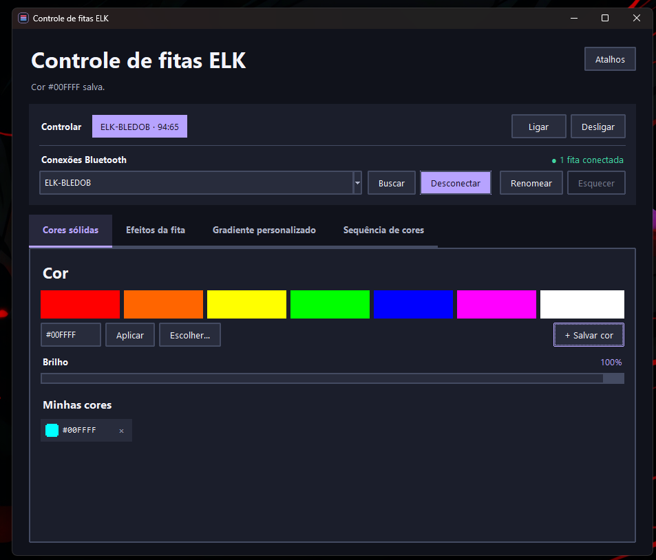

# 💡 Controle ELK

**Controle suas fitas LED Bluetooth diretamente pelo Windows.**

O **Controle ELK** é um aplicativo para Windows que permite controlar fitas LED com controladores Bluetooth **ELK-BLEDOB** e **ELK-BLEDOM**, sem depender de aplicativos para celular.

Ajuste cores e brilho, utilize os efeitos originais do controlador ou crie gradientes personalizados. Tudo em uma interface simples, com suporte a múltiplas fitas e atalhos globais.



## Funcionalidades

- **Controle de cores e brilho:** escolha cores sólidas e ajuste a intensidade da iluminação.
- **Efeitos integrados:** utilize os efeitos de fábrica disponíveis no controlador.
- **Gradientes personalizados:** crie sequências de cores com tempos configuráveis e reprodução contínua.
- **Múltiplas fitas:** conecte até três controladores simultaneamente e controle cada um individualmente ou todos de uma vez.
- **Atalhos globais:** controle a iluminação sem precisar abrir a janela do aplicativo.
- **Execução em segundo plano:** mantenha seus gradientes ativos com o aplicativo minimizado na bandeja do sistema.
- **Inicialização automática:** configure o aplicativo para iniciar junto com o Windows.

## Instalação

1. Acesse a seção **Releases** do repositório no GitHub.
2. Na versão mais recente, abra **Assets** e baixe `Controle-ELK.exe`.
3. Execute o arquivo e certifique-se de que o Bluetooth do computador esteja ativado.

## Como usar

### 1. Conectar uma fita LED

1. Clique em **Buscar** para localizar os controladores Bluetooth disponíveis.
2. Selecione sua fita na lista de dispositivos encontrados.
3. Clique em **Conectar**.

**Nota:** caso um controlador ELK-BLEDOM estabeleça conexão, mas não responda aos comandos, experimente alternar entre as variantes de protocolo `4` e `0`.

### 2. Controlar a iluminação

Após conectar, você pode ajustar as cores, alterar o brilho, selecionar efeitos de fábrica ou configurar um gradiente personalizado.

O aplicativo permite conectar até **três fitas simultaneamente**. Na opção **Controlar**, escolha um dispositivo específico ou selecione **Todas** para aplicar os comandos aos controladores conectados.

### 3. Criar gradientes personalizados

Configure uma sequência de cores e defina o tempo de cada transição.

Os gradientes podem ser reproduzidos continuamente, mesmo com a janela do aplicativo minimizada.

Na aba **Sequência de cores**, cada cor fica acesa pelo tempo escolhido e troca de uma vez. A sequência também pode tocar em loop.

## Atalhos globais

Controle suas fitas LED sem precisar alternar para a janela do aplicativo.

Os atalhos padrão são:

| Atalho | Ação |
|---|---|
| `Ctrl + F9` | Ligar a fita |
| `Ctrl + F10` | Desligar a fita |
| `Ctrl + F11` | Conectar à última fita utilizada |

Você também pode configurar atalhos para aplicar efeitos de fábrica, definir cores sólidas, avançar para a próxima cor da paleta e iniciar ou interromper gradientes e sequências. Esses dois últimos modos memorizam a última configuração reproduzida durante a sessão do aplicativo. Caso ainda não tenham sido utilizados, os atalhos executam as cores configuradas no editor.

Acesse **Atalhos** no aplicativo para ativar e configurar as combinações de teclas. Você também pode desabilitar a opção **Mostrar confirmação na tela** para executar os comandos sem exibir notificações visuais.

## Bandeja do sistema e inicialização

Ao minimizar ou fechar a janela, o Controle ELK permanece ativo na **bandeja do sistema**, permitindo continuar utilizando os atalhos e a reprodução de gradientes e sequências.

Clique com o botão direito no ícone da bandeja para acessar:

- **Abrir:** retornar à janela principal.
- **Iniciar com o Windows:** ativar ou desativar a inicialização automática.
- **Sair:** encerrar completamente o aplicativo.

As preferências e configurações são armazenadas em:

`%LOCALAPPDATA%\ControleELK\`

## Executar pelo código-fonte

Para executar o projeto diretamente pelo código-fonte, é necessário ter **Python 3.11 ou superior** instalado.

Abra o PowerShell na pasta raiz do repositório e siga os comandos.

**1. Criar o ambiente virtual**

```powershell
py -m venv .venv
```

**2. Instalar as dependências do projeto**

```powershell
.\.venv\Scripts\python.exe -m pip install -e .
```

**3. Iniciar a interface gráfica**

```powershell
.\.venv\Scripts\python.exe -m controle_elk.ui.launch
```

### Interface de linha de comando (CLI)

O projeto também oferece uma interface pelo terminal:

```powershell
.\.venv\Scripts\python.exe -m controle_elk
```

Após conectar um controlador, digite `ajuda` para consultar os comandos disponíveis.


## Licença

Este projeto é distribuído sob a licença [MIT](LICENSE).
